<div align="center">



[](https://linkedin.com/in/ylohnitram)
[](https://martin-holy.online)
[](mailto:ylohnitram@gmail.com)
[](https://github.com/Replikanti/mie)
[](https://github.com/Replikanti/agentis)

</div>

I build systems that read markets and agents that do real work: Rust research machinery for the BTC perpetual, autonomous bug hunting on Web3 audit platforms, and the harnesses that let LLM agents run unattended. Prague, remote, with 15+ years of deployment automation, DevOps and platform engineering underneath.

```text
market state → regime → conditional behavior → bias → location → trigger → execution → outcome
```

Measure first. An edge counts only if it survives replay, out-of-sample validation and an honest attempt to refute it, and "no suitable strategy" is a valid answer. Same rule for agents.

### Currently building

| Project | Area | What it is |
|---|---|---|
| [**MIE**](https://github.com/Replikanti/mie) | `btc perps` | Market Intelligence Engine for the BTCUSDT perpetual, in Rust. Maps market state, regime and order flow, measures how the market behaves in each context, and only then discovers and validates strategies. Agents run the research loop, never the numbers. |
| [**dark-factory**](https://github.com/Replikanti/agentis-colonies/tree/main/dark-factory) | `web3 security` | Autonomous security research federation: invariant fuzzing, symbolic execution (Halmos), fork-state verification. Active on Immunefi and Sherlock. |
| [**Agentis**](https://github.com/Replikanti/agentis) | `agent runtime` | Open-core platform for autonomous agents: Rust runtime, agent DSL and evolution engine, with capability-based security and cognitive budgets. |
| [**Agentis Colonies**](https://github.com/Replikanti/agentis-colonies) | `agent federations` | Ready-to-run federations under Apache 2.0: a development colony that takes issues to merged PRs, protocol monitoring, security research. |
| [**flat-cyborg**](https://github.com/Replikanti/flat-cyborg) | `llm cli harness` | PTY harness for driving LLM CLIs (Claude Code and others) from scripts and daemons, in Rust. |
| [**sdlc-bench**](https://github.com/Replikanti/sdlc-bench) | `benchmark` | Finds the cheapest (model, effort) tier per engineering task class. |

**Day job:** Senior AI Software Engineer at [Avvoka](https://www.avvoka.com/), building an AI engineering factory: a GitLab-integrated multi-agent harness that writes, reviews and ships production code.

### Stack

```yaml
languages:  Rust, TypeScript, Python, Bash, SQL, Pine Script
markets:    Binance USDⓈ-M futures (WebSocket, REST, public archive), TradingView
order flow: order book, CVD, open interest, volume profile, market structure
data:       Parquet, deterministic replay, live/replay equivalence
security:   Foundry invariant fuzzing, Halmos symbolic execution, EVM, Solana
agents:     harnesses and runtimes, multi-agent federations, Claude Code automation
infra:      GCP / GKE, Docker, Terraform, GitHub Actions
tools:      Git, Vim, Claude Code, Fedora
```

### Track record

| Project | Period | What it was |
|---|---|---|
| [Ralph Platform](https://github.com/Replikanti/ralph-platform) | 01/2026 – 03/2026 | Production-ready digital labor automation platform built with AI-augmented engineering patterns |
| [FlowLint](https://flowlint.dev) | 11/2025 – 03/2026 | Open-source static analysis suite for n8n: AST-based linting engine, CLI, GitHub App, Chrome Extension |
| Pine Script indicators | 12/2024 – 08/2025 | [Opening range breakout](https://github.com/ylohnitram/tradingview-indicators), [volume-trend](https://github.com/ylohnitram/pinev6_volumetrend) start-of-trend detector (volume + RSI), [position alerts](https://github.com/ylohnitram/tradingview-position-alert) from TradingView to Telegram |
| [price-action-analyzer](https://github.com/ylohnitram/price-action-analyzer) | 02/2025 – 03/2025 | Binance OHLCV → fair value gaps, order blocks, liquidity sweeps, swing highs/lows → AI-written swing and intraday market-structure analysis on Telegram |

### Open to

Market microstructure and quant research · trading infrastructure · Web3 / DeFi security tooling · agent harnesses, runtimes and federations · Rust · open-source developer tools

---

<div align="center"><sub>map the market · measure the edge · let the agents do the grind</sub></div>
